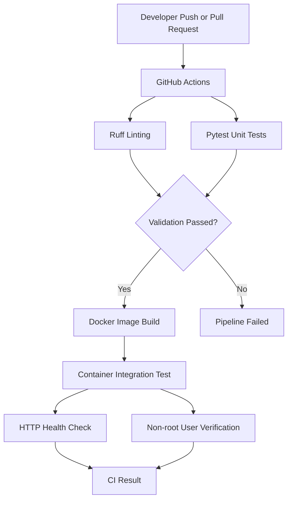
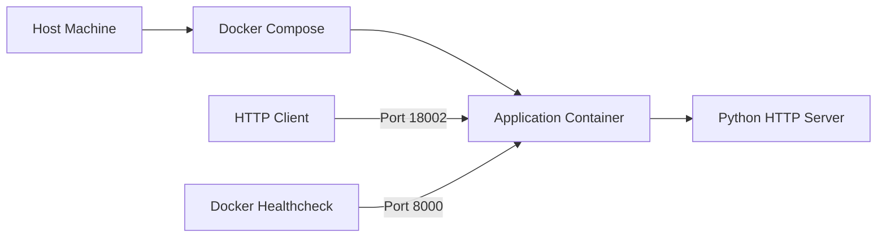

# CI/CD Deployment Pipeline Architecture

## Overview

This project automates code validation, testing, Docker image creation, and container deployment.

## CI/CD Workflow

## Deployment Architecture

## Security

- Application runs as non-root user `appuser` with UID 10001.
- Application port is published on localhost only.
- Docker healthcheck monitors the HTTP health endpoint.

## CI Pipeline Jobs

- **Lint:** validates Python code using Ruff.
- **Test:** runs unit tests using pytest.
- **Docker Build:** creates the application image.
- **Integration Test:** verifies HTTP health and non-root execution.
